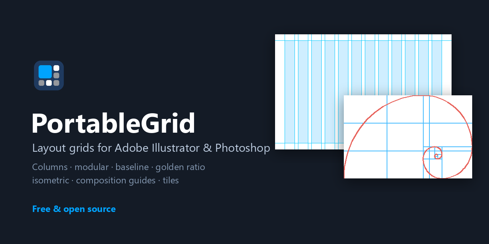
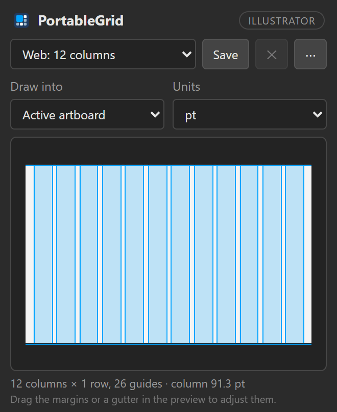
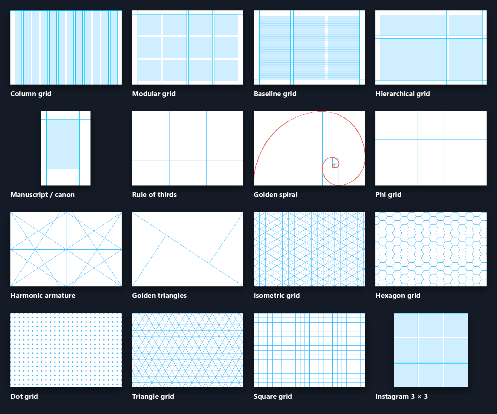
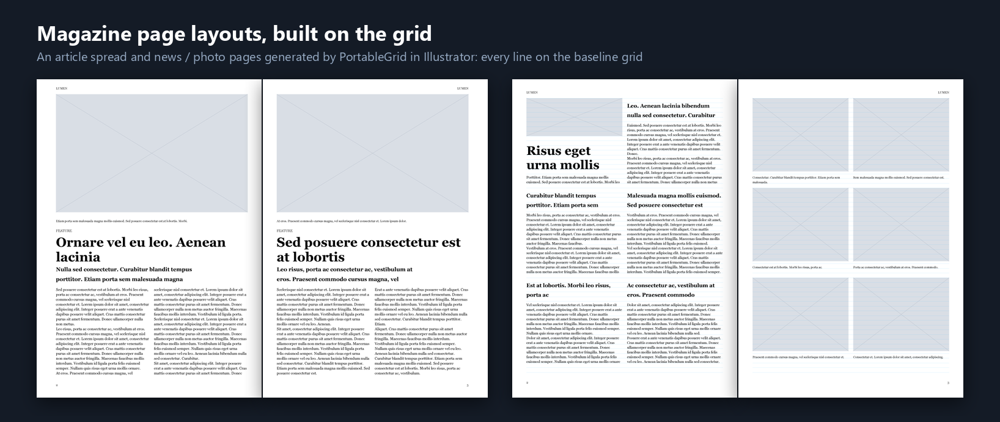
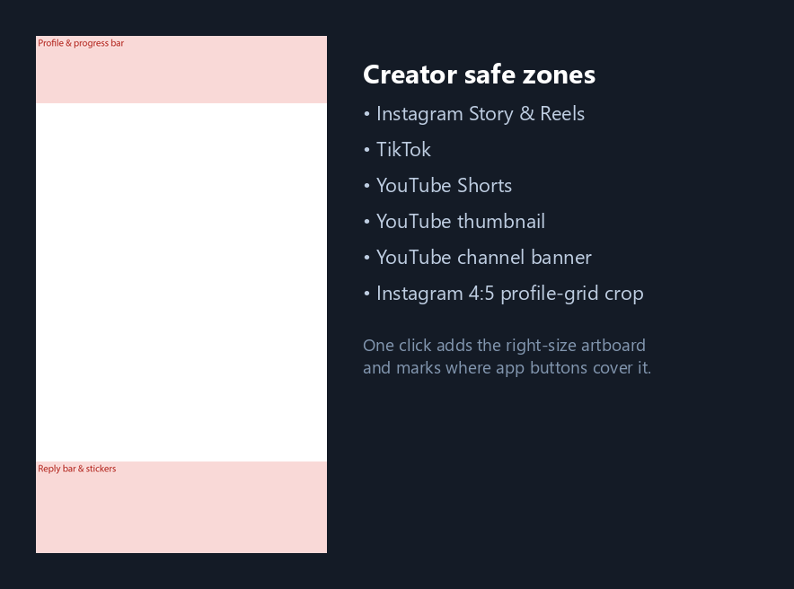

<p align="center">
  
</p>

<h1 align="center">PortableGrid: Layout Grid Generator for Adobe Illustrator &amp; Photoshop</h1>

<p align="center">
  <b>Free, open-source grid plugin for designers and creators: column, modular and baseline grids, golden ratio
  and composition guides, magazine page layouts, social media safe zones, and one-click snap-to-grid.</b>
</p>

<p align="center">
  <a href="https://github.com/vicenet/PortableGrid/releases/latest"></a>
  <a href="https://github.com/vicenet/PortableGrid/releases"></a>
  <a href="LICENSE"></a>
  
  
  
  <a href="https://github.com/vicenet/PortableGrid/actions/workflows/ci.yml"></a>
  <a href="https://scorecard.dev/viewer/?uri=github.com/vicenet/PortableGrid"></a>
</p>

<p align="center">
  <a href="https://github.com/vicenet/PortableGrid/releases/latest"><b>Download</b></a> ·
  <a href="#grid-types">Grid types</a> ·
  <a href="#magazine-page-layouts">Magazine layouts</a> ·
  <a href="#clean-up-tools">Clean-up tools</a> ·
  <a href="#features">Features</a> ·
  <a href="#faq">FAQ</a> ·
  <a href="https://github.com/vicenet/PortableStudio">PortableStudio (brand guidelines)</a>
</p>

---

<p align="center">
  
</p>

**PortableGrid** is a free **Adobe Illustrator grid plugin** and **Photoshop guides extension**. Set up
columns, rows, gutters and margins (or pick one of 33 presets, or build a harmonious grid from your text size),
see a live preview, and draw the grid as guides, cells, lines or artboards. Then let it do the tedious part:
build magazine pages on the grid, snap messy objects onto it, score how clean your layout is, and mark where
Instagram, TikTok and YouTube buttons will cover your design.

It's a free, open-source alternative to paid guide and grid plugins: no subscription, no account, and it
works in both Illustrator and Photoshop.

## Download

| Platform | File | Install |
|---|---|---|
| **Windows 10/11** | [`PortableGrid-setup.exe`](https://github.com/vicenet/PortableGrid/releases/latest) | Run the installer (no admin rights needed) |
| **macOS** (Intel & Apple silicon) | [`PortableGrid.pkg`](https://github.com/vicenet/PortableGrid/releases/latest) | Open the package and follow the steps |
| **Any ZXP installer** | [`PortableGrid.zxp`](https://github.com/vicenet/PortableGrid/releases/latest) | Signed Adobe extension |

Then restart Illustrator/Photoshop and open **Window › Extensions › PortableGrid**
(Photoshop: **Window › Extensions (Legacy)**). Requires Illustrator 2021+ and/or Photoshop 2021+.

## Grid types

<p align="center">
  
</p>

| Layout grids | Composition guides | Drawing grids |
|---|---|---|
| **Column grid**: any number of columns, gutters and margins | **Rule of thirds** | **Square grid** (graph paper, 8pt grid) |
| **Modular grid**: columns × rows of cells | **Phi grid** (golden sections) | **Dot grid** |
| **Baseline grid** for type, with offset | **Golden spiral** (flip to any corner) | **Isometric grid** (30°) |
| **Hierarchical grid**: uneven tracks like `2fr 1fr` or `240px auto` | **Golden triangles** | **Triangle grid** (60°) |
| **Manuscript grid** and the **Van de Graaf canon** | **Harmonic armature** and **diagonals** | **Hexagon grid** |
| **Fixed-width web containers** (Bootstrap 1320 px, 12 / 8 / 4 columns) | **Centre cross** | |
| **Facing pages**: margins mirror on every second artboard | | |

## Magazine page layouts

<p align="center">
  
</p>

Pick a layout and PortableGrid builds the page on your grid in Illustrator: **image frames**, a kicker,
**headline**, standfirst, **threaded body columns**, captions, pull quotes, **running heads and page numbers**
on the outside edges of **facing pages**, and full-bleed images that never cross the spine. Every text frame
puts its first baseline on the **baseline grid**, and everything is styled with editable `PG` paragraph
styles, so changing one style restyles the whole magazine.

Layouts: **article**, **feature opener**, **spread** (image left, story right), **news page**, **photo grid** and
**cover** (masthead, full-bleed image, cover lines).

## Clean-up tools

- **Harmonious grid from one number.** Type your body text size: baseline, margins, gutters and rows are
  derived from it and **locked to the baseline**, the Swiss-grid method in one click.
- **Snap to grid.** Select messy objects and click Snap: edges move to the nearest columns and rows, text
  snaps its first baseline to the baseline grid. *Move & resize* also fits objects to whole columns.
- **Grid check.** Scores how much of your page sits on the grid ("80% on grid") and outlines everything that
  doesn't, a design QA pass before you send work to a client.
- **Type styles on the grid.** Paragraph styles from a modular type scale (minor third to golden ratio) whose
  leading is always a whole number of baselines.

## Creator safe zones

<p align="center">
  
</p>

Presets for **Instagram Story and Reels**, **TikTok**, **YouTube Shorts**, the **YouTube thumbnail** and
**channel banner**, and the **Instagram 4:5 profile-grid crop**. One click adds an artboard (or a Photoshop
document) at the right size and marks where profile bars, captions and buttons will cover your design.
Platforms change their apps, so treat the zones as a close guide.

## Features

- **Live preview** of the grid on your artboard, canvas or selection, updated as you type.
- **Any unit in any field**: `20`, `20px`, `5mm`, `12pt`, `0.5in` or `10%`.
- **Draw it your way**: guides, coloured cells, styled lines (colour, weight, opacity) or, in Illustrator,
  everything as guides. Grids go on their own layer and can be cleared or replaced in one click.
- **Where you need it**: the active artboard, all artboards, the selection, or each selected object.
- **Artboard per cell** (Illustrator): turn a grid into artboards for carousels, social posts or contact sheets.
- **Arrange into cells** (Illustrator): drop selected images or objects into the grid, fit, fill and crop, or stretch.
- **Split into tiles** (Illustrator): cut artwork into clipped tiles, with gutters as gaps.
- **Export tiles** as numbered PNG/JPEG files: perfect for **Instagram 3 × 3 profile grids** and **seamless carousels**.
- **Lock rows to the baseline grid** so text lines up across every module.
- **Drag to adjust**: drag the margins or a gutter in the live preview.
- **Grids live in your document**: settings are saved with the file, each artboard can have its own grid,
  and grids redraw themselves when you resize an artboard.
- **One undo** removes a whole grid or layout.
- **Your own content in layouts**: paste or load an article, pick a folder of images, or use a
  [PortableStudio](https://github.com/vicenet/PortableStudio) brand's fonts, copy and photos. Text that doesn't fit
  is flagged with a red +.
- **Keyboard shortcuts** in the panel, plus Toggle grid, Snap and Grid check in Illustrator's File › Scripts menu.
- **Share presets** with your team: export and import preset files.
- **Update notice** when a new version is out (can be turned off).
- **33 presets** for web, print, editorial, composition, drawing, creator and social layouts, plus your own saved presets.

## How it works

1. **Pick a preset**, build a **harmonious grid** from your text size, or set margins, columns, rows, a
   baseline, a drawing grid or composition guides.
2. **Choose where to draw**: active artboard, all artboards, selection or each selected object.
3. **Draw grid.** Change anything and draw again: the previous grid is replaced. **Clear** removes it.
4. **Design on it**: build a page layout, snap objects to the grid, and run Grid check before you export.

## For developers

```bash
git clone https://github.com/vicenet/PortableGrid.git
cd PortableGrid
powershell -ExecutionPolicy Bypass -File scripts\dev-install.ps1   # Windows
sh scripts/dev-install.sh                                           # macOS
npm test
npm run package                                                     # release builds in dist/
```

Plain JavaScript (Adobe CEP panel) and ExtendScript, with no dependencies. See [docs/SIGNING.md](docs/SIGNING.md)
for signed installers and [docs/ADOBE-EXCHANGE.md](docs/ADOBE-EXCHANGE.md) for the Adobe Exchange listing. The grid maths lives in
[`core/grid.js`](core/grid.js) and is fully tested. Releases are built by GitHub Actions: pushing a `v*` tag
builds the Windows `.exe` and macOS `.pkg`.

```
index.html, css/, js/   Panel UI and live preview
core/grid.js            Layout engine: tracks, baselines, drawing grids, composition guides, safe zones
core/layouts.js         Magazine page layouts on a grid
host/                   ExtendScript for Illustrator / Photoshop
config/presets.json     Built-in presets
installer/              Windows (Inno Setup) and macOS (pkgbuild) installers
```

## FAQ

**Is PortableGrid free?** Yes. It's free and open source under GPL-3.0, for personal and commercial work.

**How is it different from Illustrator's "Split into Grid" or Photoshop's "New Guide Layout"?** Those make
simple equal grids. PortableGrid adds baseline grids, uneven (hierarchical) columns, golden ratio and
composition guides, isometric, hexagon and dot grids, facing pages, presets, a live preview, and works the
same in both apps.

**Can I use it for Instagram grids and carousels?** Yes. Use the Instagram presets, then *Export tiles* to
save each square or slide as a numbered image ready to post.

**Can it make magazine layouts?** Yes, in Illustrator: set up a grid with a baseline (or use the *Magazine
spread* preset), then *Page layouts › Build layout*. Text is threaded, aligned to the baseline grid and styled
with paragraph styles you can edit. For long documents with many pages, InDesign is still the better tool.

**Does it change my artwork?** Drawing a grid only adds a `PortableGrid` layer (Illustrator) or guides and
`PortableGrid` layers (Photoshop). *Arrange* and *Split* change the selected artwork, and can be undone.

**Why does Windows/macOS warn when installing?** The installers aren't signed with paid developer
certificates yet. They're built by GitHub Actions from this public source code.

## Licence

[GPL-3.0](LICENSE). [Privacy](PRIVACY.md): no account, no tracking. Found a security problem? See [SECURITY.md](SECURITY.md). PortableGrid is an independent
project, not affiliated with Adobe. Illustrator and Photoshop are trademarks of Adobe Inc.

Also by the same author: [**PortableStudio**](https://github.com/vicenet/PortableStudio), a free brand
guidelines generator for Illustrator and Photoshop.

⭐ **If PortableGrid saves you time, star the repo.** It helps other designers find it.
